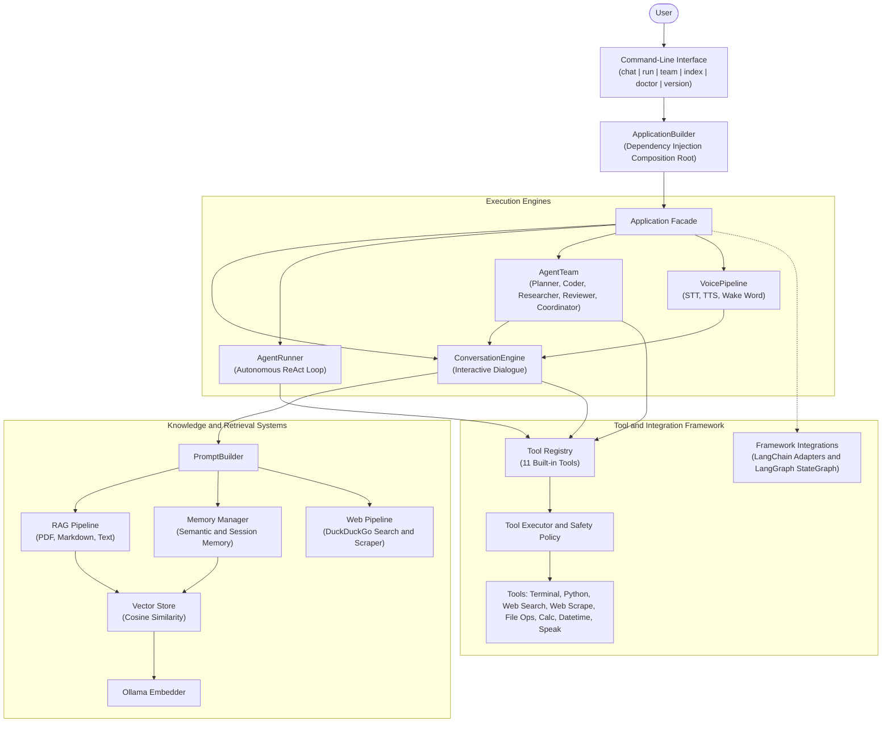

# Aether

> **A modular, local-first AI engineering platform built with privacy, transparency, extensibility, and software engineering best practices at its core.**


---

# What is Aether?

Aether is an open-source AI engineering project focused on building a **production-quality local AI assistant** from the ground up.

Rather than being developed as a rapid prototype, Aether is intentionally engineered using professional software engineering principles including modular architecture, clean design, testing, documentation, and long-term maintainability.

The project serves two complementary purposes:

- Build a capable local-first AI assistant.
- Demonstrate modern AI engineering through incremental, production-quality development.

Every epic introduces new architectural concepts while maintaining a stable and extensible codebase.

---

# Vision

Aether aims to evolve into a complete AI engineering platform capable of:

- Natural conversation
- Long-term memory
- Tool execution
- Retrieval-Augmented Generation (RAG)
- Web intelligence
- Voice interaction
- Multi-agent collaboration
- Local-first execution
- Privacy-preserving AI

---

# Engineering Principles

The project is guided by a small set of engineering principles:

- **Local First** — Execute locally whenever practical.
- **Privacy Focused** — User data remains under the user's control.
- **Framework Independent** — External frameworks remain integrations, not architectural foundations.
- **Modular Architecture** — Components are independently replaceable.
- **Production over Prototype** — Prioritize maintainability, testing, and documentation.
- **Documentation First** — Architecture and design before implementation.
- **Engineering Excellence** — Build features on top of strong engineering foundations.

---

# Current Features

## Core AI Platform

- Local LLM integration using Ollama
- Modular Conversation Engine
- Session Management
- Persistent conversation history
- Conversation clearing with `/clear`
- Prompt Builder
- YAML Configuration System
- Typed Configuration Models
- Structured Logging
- Custom Exception Hierarchy
- Factory Pattern
- Application Bootstrap
- Interactive Command-Line Interface
- Local-first conversations

## Memory System

Aether includes a modular, persistent, local-first long-term memory system.

Current capabilities:

- Persistent JSON-based memory storage
- Typed memory models using Pydantic
- Modular memory architecture
- Dependency-injected `MemoryManager`
- Abstract storage interface (`BaseMemoryStore`)
- JSON storage backend (`JsonMemoryStore`)
- Rule-based automatic memory extraction
- Profile, preference, and project memory categories
- Memory deduplication
- Memory update and deletion
- Embedding abstraction
- Ollama-based embeddings
- Abstract vector store interface (`BaseVectorStore`)
- In-memory vector store
- Semantic memory retrieval
- Memory summarization
- Memory consolidation
- Integration with the `ConversationEngine`

The current memory extractor uses deterministic rule-based patterns. This provides a reliable foundation for future LLM-based memory extraction.

## Tool Framework

Aether includes a modular tool execution framework that allows the LLM to perform actions through registered tools.

Current capabilities:

- Generic `BaseTool` abstraction
- Typed tool arguments using Pydantic
- Tool definitions with descriptions and input schemas
- Tool registry for managing available tools
- Tool execution pipeline
- Tool policy for controlling tool access
- Multi-round LLM tool calling
- Tool result handling
- Tool execution error handling
- Maximum tool round protection

### Built-in Tools

- Calculator
- Date and time lookup
- File information
- Read file (reads workspace text with line slicing)
- Write file (writes or appends text, auto-creates parent folders)
- List directory (inspects files and subdirectories with sizes and types)
- Web search (`web_search` - zero-API-key internet querying)
- Web scrape (`web_scrape` - extracts clean text from URLs)
- Speak (`speak` - vocalizes messages and audio responses via TTS)
- Python code execution
- Terminal command execution

### Safety Mechanisms

The current tool framework includes basic execution safety mechanisms:

- Tool access control through `ToolPolicy`
- Configurable maximum tool execution rounds
- File read size threshold guard (5MB limit prevents memory spikes)
- Python execution timeout handling
- Terminal execution timeout handling
- Python execution in a separate subprocess
- Temporary Python file cleanup
- Basic AST-based Python safety validation
- Blocking of unsafe Python modules including:
  - `os`
  - `subprocess`
  - `shutil`
  - `socket`
- Blocking of unsafe Python functions including:
  - `eval`
  - `exec`
  - `compile`
  - `__import__`
- Blocking of destructive terminal commands including:
  - `del`
  - `erase`
  - `rmdir`
  - `rd`
  - `format`
  - `shutdown`
  - `restart`
- Basic detection of unsafe terminal commands in chained commands

These mechanisms provide a basic safety layer and are intended as a foundation for stronger sandboxing and permission systems in future development.

## Retrieval-Augmented Generation (RAG)

Aether includes a local-first RAG subsystem enabling grounded conversations over external documents.

Current capabilities:

- **Document Loaders**: Extensible `TextLoader`, `MarkdownLoader`, `PDFLoader` (multi-page PDF text extraction via `pypdf`), and `DocumentLoaderFactory` with recursive directory traversal
- **Sliding-Window Chunker**: `TextChunker` with configurable size, overlap, and natural boundary snapping (newlines and whitespace)
- **Persistent Storage**: `JsonChunkStore` (`data/rag_chunks.json`) preserves chunks across application restarts
- **Startup Re-indexing**: `rag_pipeline.reindex()` embeds all stored chunks on launch so `aether chat` immediately has document access
- **Source Deduplication**: Re-indexing a file updates chunks in-place cleanly without duplicate accumulation
- **Semantic Retrieval**: Cosine similarity search with minimum score thresholding
- **Citations & System Injection**: Retrieved passages formatted as source-cited snippets and injected into system prompt context
- **CLI Ingestion**: `aether index <path>` command to index files or directories on demand

## Agentic ReAct Loop

Aether features an autonomous multi-step reasoning and action loop (`AgentRunner`) implementing the ReAct pattern.

Current capabilities:

- **Reason -> Act -> Observe Cycle**: LLM reasons about the goal, decides on actions, and inspects observations
- **Thought Capture**: Extracts LLM reasoning text (`THOUGHT`) alongside tool call requests
- **Multi-Step Execution**: Chains tools dynamically across multiple rounds to solve complex goals
- **Structured Tracing**: Typed `AgentStep` (`THOUGHT`, `ACTION`, `OBSERVATION`, `ANSWER`) recorded in `AgentTrace`
- **Budget Control**: Configurable `max_steps` budget prevents infinite loops
- **Graceful Fallback Synthesis**: If step limit is reached, prompts LLM for best-effort synthesis from observed evidence
- **Fault-Tolerant Feedback**: Tool execution errors and policy denials are fed back as observations so the agent can self-correct
- **CLI Execution**: `aether run "GOAL" [--max-steps N] [--show-trace]` for autonomous goal execution

## AI Framework Integrations (LangChain & LangGraph)

Aether maintains strict architectural independence while offering zero-lock-in adapter bridges in `app/integrations/`:

- **LangChain Adapter Suite**:
  - `LangChainPromptTemplate`, `MessagePromptTemplate`, and `ChatPromptTemplate` for message and prompt templating.
  - Bidirectional tool adapters: `AetherToolAdapter` (exposes native `BaseTool` instances to LangChain with auto-generated Pydantic schemas) and `LangChainToolAdapter` (wraps external LangChain tools for native Aether use).
  - `AetherLangChainLLM`: Wraps Aether's `BaseLLM` with `.invoke()`, `.generate()`, and `.bind_tools()`.
  - `AetherChain` implementing the Unix-style pipe syntax (`prompt | llm | transform`) and `RouterChain` for branching logic.
- **LangGraph Workflow Engine**:
  - `GraphState` schema and `append_reducer` for monotonic message and trace accumulation.
  - `StateGraph` and `CompiledGraph` supporting cyclical nodes, conditional routers, streaming state updates, and step-budget protection.
  - `GraphReActAgent`: Cyclic Reason -> Act -> Observe workflow orchestrator with state checkpointing.
- **Application Factory Methods**:
  - `app.get_langchain_model()`: Exposes the active LLM as a LangChain-compatible model.
  - `app.create_graph_agent()`: Instantiates a graph-driven ReAct agent backed by the application's engine and tool executor.

## Web Intelligence Subsystem

Aether includes internet-aware capabilities enabling both conversational and autonomous agents to explore the web:

- **Zero-API-Key Web Search**: `DuckDuckGoSearch` queries internet sources and unwraps redirect URLs cleanly with no external API keys required.
- **HTML Content Extraction**: `ContentExtractor` strips scripts, navigation, footers, and advertisement markup using BeautifulSoup, extracting clean article body text and metadata.
- **Web Scraper**: `WebScraper` fetches HTTP/HTTPS URLs with realistic browser headers, redirect following, and size truncation safeguards.
- **Multi-Source Research Pipeline**: `WebPipeline` coordinates multi-page searches, page fetching, and LLM-grounded research synthesis.
- **Agent Tool Integration**: `WebSearchTool` (`web_search`) and `WebScrapeTool` (`web_scrape`) registered by default in the tool registry.

## Voice Subsystem

Aether includes a local-first, low-latency audio interaction subsystem for speech input and vocal output:

- **Local Speech-to-Text (STT)**: `WhisperSTT` supports local transcription via `faster-whisper` and `openai-whisper` with graceful fallback and lazy loading.
- **Offline Text-to-Speech (TTS)**: `Pyttsx3TTS` provides 100% offline, local speech synthesis via Windows SAPI5 / system speech engines with zero cloud dependencies, configurable rate/volume, and `.wav` export.
- **Wake Word Detection**: `KeywordWakeWordDetector` matches wake triggers (e.g., "Aether", "Hey Aether") with regex normalization and strips wake prefixes from voice queries.
- **End-to-End Voice Pipeline**: `VoicePipeline` orchestrates audio transcription, wake word verification, conversation turn processing (`process_voice_turn`), and speech synthesis.
- **Agent Vocalization Tool**: `SpeakTool` (`speak`) enables autonomous agents to speak directly to the user.

## Multi-Agent Subsystem

Aether expands into a collaborative multi-agent platform featuring specialized personas working together via a shared Blackboard:

- **Planner Agent (`PlannerAgent`)**: Decomposes high-level user goals into structured `TaskPlan`s with subtask dependencies and role assignments.
- **Research Agent (`ResearchAgent`)**: Specializes in gathering factual information using internet search (`web_search`), web page scraping (`web_scrape`), and workspace file inspection.
- **Coder Agent (`CoderAgent`)**: Authors modular code, manipulates workspace files (`read_file`, `write_file`), executes Python scripts, and verifies terminal commands.
- **Reviewer Agent (`ReviewerAgent`)**: Inspects deliverables for correctness, security, and edge cases, providing structured QA critiques with `APPROVED` or `NEEDS_REVISION` verdicts.
- **Coordinator Agent (`CoordinatorAgent`)**: Supervises execution, resolves conflicts, and synthesizes unified, publication-grade user deliverables.
- **Shared Blackboard (`Blackboard`)**: Central state repository for completed subtask results, shared artifacts, and inter-agent messages.
- **Agent Team Orchestrator (`AgentTeam`)**: Manages the end-to-end multi-agent lifecycle (`solve()`) and direct specialist delegation (`delegate()`).
- **Dynamic Delegation Tool (`DelegateTaskTool`)**: Enables any agent or ReAct loop to dynamically delegate subtasks to specialists during runtime.
- **CLI Workflow**: `aether team "GOAL" [--no-plan]` executes the full collaborative multi-agent workflow.

## Engineering Excellence

- Modern Python packaging with `uv`
- PEP 621 compliant project configuration
- Hatchling build backend
- GitHub Actions Continuous Integration
- Ruff linting and formatting
- Pytest suite (369 tests, 89% test coverage)
- Debug subsystem
- Diagnostics subsystem (`aether doctor`)
- Documentation-first development workflow

---

# Planned Capabilities

Aether's future roadmap includes:

- Production Deployment & REST API (FastAPI)
- Desktop / Web User Interface
- Docker containerization & cloud packaging

A detailed development roadmap is available in `docs/ROADMAP.md`.

---

# Architecture

Aether follows a layered architecture designed to keep business logic independent from infrastructure.



Detailed architectural documentation is available in `docs/ARCHITECTURE.md`.

---

# Technology Stack

## Current

- Python
- Ollama
- Pydantic
- PyYAML
- uv
- Hatchling
- Ruff
- Pytest

## Planned

- LangChain
- LangGraph
- SQLite
- ChromaDB
- FastAPI
- Playwright
- Faster-Whisper
- Piper

---

# Installation

Clone the repository:

```bash
git clone https://github.com/RishabGoel11/Aether.git
cd Aether
```

Install dependencies:

```bash
uv sync --extra dev
```

Run the interactive chat:

```bash
uv run aether chat
```

Run autonomous agentic goals (ReAct loop):

```bash
uv run aether run "Calculate 15 factorial" --show-trace
```

Run collaborative multi-agent problem solving:

```bash
uv run aether team "Design a Python CLI tool for checking site uptime"
```

Index documents into the local RAG knowledge base:

```bash
uv run aether index ./docs
```

Run diagnostics:

```bash
uv run aether doctor
```

Display the version:

```bash
uv run aether version
```

Aether requires a locally running Ollama installation with the configured LLM and embedding model available.

---

# Development

Run tests:

```bash
uv run pytest
```

Run linting:

```bash
uv run ruff check .
```

Format code:

```bash
uv run ruff format .
```

Aether uses:

- `pyproject.toml` as the single source of truth for project configuration.
- `uv.lock` to ensure reproducible development environments.

---

# Project Status

| Epic | Status |
| --- | --- |
| Epic 0 – Engineering Foundations | ✅ Complete |
| Epic 1 – Core Conversation Engine | ✅ Complete |
| Epic 2 – Engineering Excellence | ✅ Complete |
| Epic 3 – Memory System | ✅ Complete |
| Epic 4 – Tool Framework | ✅ Complete |
| Epic 5 – Retrieval-Augmented Generation (RAG) | ✅ Complete |
| Epic 6 – Agentic ReAct Loop | ✅ Complete |
| Epic 7 – AI Framework Integrations | ✅ Complete |
| Epic 8 – Web Intelligence | ✅ Complete |
| Epic 9 – Voice | ✅ Complete |
| Epic 10 – Multi-Agent System | ✅ Complete |
| Epic 11 – Production | ⬜ Planned |

For detailed milestones and implementation tasks, see `docs/ROADMAP.md`.

---

# Latest Release

## v0.10.0 — Multi-Agent System

Highlights of this release:

- **Multi-Agent Subsystem (`app/multi_agent/`)**:
  - `PlannerAgent`: Autonomous goal decomposition into structured `TaskPlan`s with dependency management
  - `ResearchAgent`: Fact gathering, internet searches (`web_search`), web scraping (`web_scrape`), and document exploration
  - `CoderAgent`: Software development, file operations (`read_file`, `write_file`), Python execution, and test runs
  - `ReviewerAgent`: Quality assurance, security analysis, edge-case critiques, and structured verdicts (`APPROVED` / `NEEDS_REVISION`)
  - `CoordinatorAgent`: Supervisor orchestrating workflow execution and synthesizing publication-ready deliverables
  - `Blackboard`: Central state repository tracking task outputs, shared artifacts, and inter-agent messages
  - `AgentTeam`: High-level orchestration facade executing the collaborative team workflow (`solve()`) and direct specialist delegation (`delegate()`)
  - `DelegateTaskTool` (`delegate_task`): Tool enabling agents and ReAct runners to dynamically delegate subtasks to specialists
- **CLI Workflow**:
  - `aether team "GOAL" [--no-plan]`: Command to initiate collaborative multi-agent problem solving
- **Test Suite & Engineering**:
  - 23 new unit tests across multi-agent models, blackboard, specialists, team orchestrator, delegate tool, builder, and CLI
  - 369 total unit tests passing with 89% code coverage

### Prior Release Highlights

- **v0.9.0 — Voice Subsystem**: Local Speech-to-Text (`WhisperSTT`), 100% offline Text-to-Speech (`Pyttsx3TTS`), Wake Word Detection (`KeywordWakeWordDetector`), end-to-end `VoicePipeline`, and agent `SpeakTool` (`speak`).
- **v0.8.0 — Web Intelligence**: Zero-API-key DuckDuckGo search, HTML content extraction, web scraping, multi-source research pipeline, `web_search` and `web_scrape` agent tools, and multi-page PDF ingestion (`PDFLoader`).
- **v0.7.0 — AI Framework Integrations**: LangChain prompt/tool/LLM adapters, LCEL `|` pipe chains, LangGraph `StateGraph`, `CompiledGraph`, and `GraphReActAgent`.
- **v0.6.0 — Agentic ReAct Loop**: Autonomous `AgentRunner` driving Reason -> Act -> Observe multi-step execution, full reasoning trace capturing (`THOUGHT`, `ACTION`, `OBSERVATION`, `ANSWER`), step budget control with graceful synthesis fallback, and `aether run` CLI.
- **v0.5.0 — Retrieval-Augmented Generation (RAG)**: Extensible document loaders (`TextLoader`, `MarkdownLoader`), sliding-window chunking with boundary snapping, persistent `JsonChunkStore` (`data/rag_chunks.json`), startup re-indexing, cosine similarity retrieval, source citation formatting, and `aether index` CLI command.
- **v0.4.0 — Tool Framework**: Modular `BaseTool` abstraction, `ToolRegistry`, `ToolExecutor`, `ToolPolicy`, built-in tools (Calculator, Datetime, Python, Terminal, FileInfo).
- **v0.3.0 — Memory System**: Persistent JSON memory store, rule-based extraction, semantic vector search, memory summarization & consolidation.

The next major milestone is **Epic 11 – Production**.

---

# Documentation

The `docs/` directory contains the project's technical documentation, including:

- Architecture
- Development Roadmap
- Engineering Decisions
- Project Master
- Engineering Journal
- Changelog

---

# Development Workflow

Every feature in Aether follows a structured engineering lifecycle:

1. Architecture discussion
2. Design review
3. Implementation
4. Testing
5. Documentation
6. Pull Request review
7. Git commit
8. GitHub release

This workflow ensures Aether evolves through disciplined, production-quality engineering.

---

# Contributing

Aether is currently under active development.

Contribution guidelines will be added once the core architecture reaches a stable state.

---

# License

Licensed under the **MIT License**.