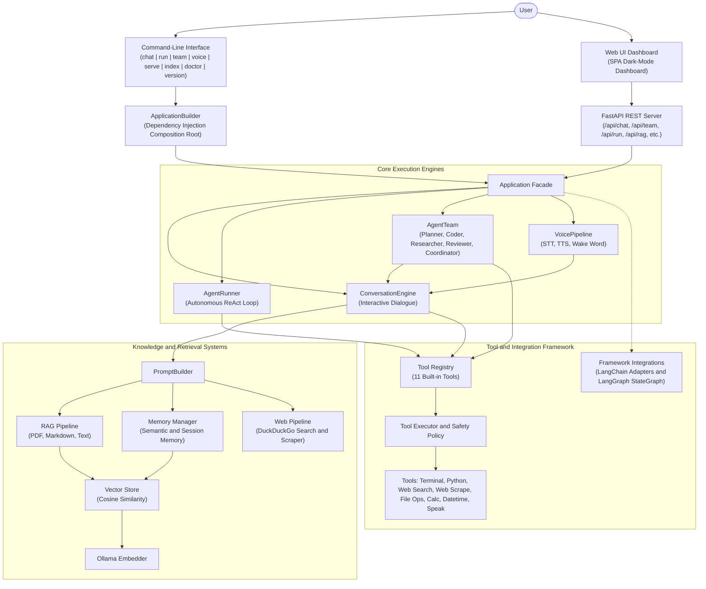

# Aether System Architecture

> **Version:** v0.11.0 (Production & Web Platform)
> This document describes the current architecture of Aether and its intended long-term evolution.

---

# Overview

Aether is a modular, local-first AI engineering platform built around clean architecture, dependency injection, and replaceable components.

The project emphasizes:

* Local-first execution
* Privacy-first design
* Modular architecture
* Testability
* Production-quality engineering

Each subsystem has a single responsibility and communicates through well-defined interfaces.

---

# High-Level Architecture



---

# Architectural Principles

## Separation of Concerns

Every module owns exactly one responsibility.

Business logic, infrastructure, persistence, and presentation remain independent.

---

## Dependency Inversion

High-level components depend on abstractions rather than implementations.

Example:

```text
ConversationEngine
        │
        ▼
MemoryManager
        │
        ▼
BaseMemoryStore
        │
        ▼
JsonMemoryStore
```

Implementations may change without affecting higher layers.

---

## Dependency Injection

Object creation occurs only inside the bootstrap layer.

Components never instantiate their own dependencies.

Example:

* ConversationEngine receives an LLM.
* MemoryManager receives a BaseMemoryStore.
* Application receives both Engine and MemoryManager.

---

## Local First

The default implementation avoids unnecessary cloud dependencies.

Current implementation uses:

* Ollama
* Local JSON storage

Future cloud providers will remain optional.

---

## Privacy First

User conversations and memories remain on the local machine unless explicitly configured otherwise.

Runtime data is excluded from version control.

---

## Extensibility

New functionality should be added by introducing new modules rather than modifying existing ones.

Examples include:

* Additional LLM providers
* New memory stores
* Tool plugins
* Retrieval engines

---

# Layered Architecture

---

## Presentation Layer

Responsible for user interaction and command dispatching.

### Current Components

* CLI (`main.py`, `parser.py`)
* Commands: `chat`, `run`, `index`, `doctor`, `version`

### Responsibilities

* Parse command-line flags and positional arguments
* Display formatted responses, streaming output, and diagnostic check tables
* Present full agent execution traces when `--show-trace` is supplied
* Handle user-facing errors gracefully

---

## Bootstrap Layer

Responsible for constructing and wiring the application composition root.

### Current Components

* `Application`
* `ApplicationBuilder`

### Responsibilities

* Load configuration (`Settings`, `RAGSettings`, `ToolPolicyConfig`)
* Configure structured logging
* Instantiate infrastructure providers (`OllamaLLM`, `OllamaEmbedder`, `JsonMemoryStore`, `JsonChunkStore`, `InMemoryVectorStore`)
* Instantiate application services (`ConversationEngine`, `AgentRunner`, `RAGPipeline`, `MemoryManager`, `ToolRegistry`, `ToolExecutor`)
* Perform automated startup re-indexing (`rag_pipeline.reindex()`)

---

## Application Layer

Coordinates high-level AI workflows, agentic loops, and context assembly.

### Current Components

* `ConversationEngine` (interactive multi-turn dialogue with memory and RAG context injection)
* `AgentRunner` (autonomous multi-step ReAct Reason->Act->Observe execution)
* `RAGPipeline` (high-level facade unifying indexing, vector retrieval, and citation formatting)
* `MemoryManager` (semantic retrieval, rule extraction, consolidation, summarization)
* `PromptBuilder` (dynamic prompt composition)
* `Session` (sliding window message history)

### Responsibilities

* Coordinate conversations and autonomous agent loops
* Maintain conversation state across turns
* Execute tool calls and feed back observations
* Format retrieved documents into citations

---

## Domain Layer

Defines core business models, contracts, and abstract interfaces.

### Current Components

* LLM Interfaces: `BaseLLM`, `LLMResponse`, `Message`, `Role`, `ToolCallRequest`
* Memory Interfaces: `BaseMemoryStore`, `MemoryRecord`, `MemoryCategory`
* Tool Interfaces: `BaseTool`, `ToolResult`, `ToolDefinition`
* RAG Interfaces: `BaseChunkStore`, `Document`, `Chunk`, `SearchResult`
* Agent Interfaces: `AgentStep`, `AgentTrace`, `AgentResult`, `StepType`
* Vector Store Interfaces: `BaseVectorStore`, `BaseEmbedder`
* Custom Exception Hierarchy

### Responsibilities

* Define abstract contracts and interfaces
* Define shared Pydantic data models
* Remain strictly independent of infrastructure details

---

## Infrastructure Layer

Provides concrete external service integrations and persistent storage.

### Current Components

* `OllamaLLM` (local Ollama text completion / chat API)
* `OllamaEmbedder` (local Ollama embeddings via `nomic-embed-text`)
* `JsonMemoryStore` (`data/memories.json`)
* `JsonChunkStore` (`data/rag_chunks.json`)
* `InMemoryVectorStore` (cosine similarity search)
* Built-in Tools: `PythonExecutionTool`, `TerminalExecutionTool`, `CalculatorTool`, `DateTimeTool`, `FileInfoTool`
* `ConfigLoader` (YAML configuration parser)
* `Logger` (structured JSON / console logging)
* Diagnostics (`Doctor`, checks runner)

---

# Current Runtime Flow

```text
User
 │
 ▼
CLI
 │
 ▼
ApplicationBuilder
 │
 ▼
Application
 │
 ▼
ConversationEngine
 │
 ├───────────────┐
 ▼               ▼
Session     PromptBuilder
                 │
                 ▼
             LLMFactory
                 │
                 ▼
             OllamaLLM
                 │
                 ▼
            Local Ollama
```

---

# Memory Architecture

The Memory Foundation has been implemented.

Current architecture:

```text
ConversationEngine

MemoryManager

BaseMemoryStore

JsonMemoryStore

data/memories.json
```

Current capabilities:

* Typed memory models
* Persistent JSON storage
* Memory manager
* Storage abstraction
* Dependency injection

Future capabilities:

* Conversation persistence
* Memory retrieval
* Prompt integration
* Automatic memory extraction
* Semantic search
* Vector databases

---

# Diagnostics Architecture

```text
Diagnostic Checks
        │
        ▼
Doctor
        │
        ▼
Diagnostic Renderer
        │
        ▼
CLI
```

Current checks include:

* Python version
* Configuration loading
* Ollama package
* Ollama server
* Configured model

---

# Debug Architecture

```text
ConversationEngine
        │
        ▼
DebugCollector
        │
        ▼
DebugRenderer
```

Captured information includes:

* Response time
* Prompt length
* Message count
* Debug events

---

# Testing Architecture

Aether separates production code from testing infrastructure.

Current structure:

```text
tests/

├── unit/
├── integration/
├── fakes/
└── conftest.py
```

Testing philosophy:

* Unit tests verify isolated components.
* Integration tests verify collaboration between components.
* Fake implementations replace external services.
* Production code never depends on testing utilities.

---

# RAG Architecture (Retrieval-Augmented Generation)

Aether includes a local-first RAG subsystem for external knowledge retrieval:

```text
Document (file / directory)
     │
     ▼
DocumentLoaderFactory (TextLoader, MarkdownLoader)
     │
     ▼
TextChunker (Sliding window + boundary snapping)
     │
     ▼
DocumentIndexer
     ├──► BaseChunkStore (JsonChunkStore -> data/rag_chunks.json)
     └──► BaseVectorStore (InMemoryVectorStore -> Cosine Similarity)

User Query
     │
     ▼
DocumentRetriever (OllamaEmbedder / nomic-embed-text)
     │
     ▼
SearchResult (Ranked passages + similarity scores)
     │
     ▼
RAGPipeline.format_context() (Source citations [N])
     │
     ▼
PromptBuilder (Injected into System Context)
     │
     ▼
ConversationEngine -> LLM Response
```

Components:
* **Models**: `Document`, `Chunk`, `SearchResult`
* **Loaders**: Extensible loaders (`TextLoader`, `MarkdownLoader`, `DocumentLoaderFactory`) with directory traversal
* **Chunker**: Character-level sliding window with natural boundary snapping on whitespace/newlines
* **Storage**: Persistent `JsonChunkStore` with startup re-indexing into `InMemoryVectorStore`
* **Retriever**: Cosine similarity search with score thresholding
* **CLI**: `aether index <path>` command for ingestion

---

# Agentic Architecture (ReAct Loop)

Aether includes an autonomous multi-step reasoning and action loop (`AgentRunner`) implementing the ReAct pattern:

```text
User Goal: "Calculate 15 factorial and save to file"
      │
      ▼
AgentRunner.run(goal, max_steps=20)
      │
      ▼
┌───► Step N: Reason -> Act -> Observe
│       │
│       ├── 1. PROMPT: System prompt + Tool schemas + Trace history
│       │
│       ├── 2. REASON: LLM outputs Thought + ToolCallRequest
│       │      Record: AgentStep(type=StepType.THOUGHT, content="...")
│       │      Record: AgentStep(type=StepType.ACTION, tool="python_exec", input={...})
│       │
│       ├── 3. ACT: ToolExecutor dispatches via ToolPolicy
│       │      Subprocess executes isolated Python / Terminal command
│       │
│       ├── 4. OBSERVE: Output captured
│       │      Record: AgentStep(type=StepType.OBSERVATION, content="...")
│       │
│       └── 5. EVALUATE:
│              ├── LLM answered with final text? ──► Terminate: StepType.ANSWER
│              ├── Max steps reached? ────────────► Fallback LLM synthesis
│              └── More work needed? ─────────────► Loop back to Step N+1
└──────────────────────────────────────────────────┘
      │
      ▼
AgentResult(success=True, answer="...", trace=AgentTrace, total_steps=N)
```

### Components (`app/agent/`)

* **`models.py`**:
  - `StepType`: `THOUGHT`, `ACTION`, `OBSERVATION`, `ANSWER`
  - `AgentStep`: Immutable record of a single step in the reasoning chain
  - `AgentTrace`: Collection of steps with formatted printable output
  - `AgentResult`: Final outcome containing the final answer, trace, success status, and step count
* **`runner.py` (`AgentRunner`)**:
  - Decoupled from `ConversationEngine`
  - Drives autonomous multi-turn loops up to `max_steps`
  - Tolerates missing tools and policy rejections by passing error messages as observations
  - Executes fallback synthesis if step budget is exhausted

---

# AI Framework Integrations Subsystem

Aether maintains strict architectural independence from third-party agent frameworks while offering zero-friction adapter bridges in `app/integrations/`.

```text
                                +---------------------------+
                                |      Aether Core          |
                                | (BaseLLM, BaseTool, etc.) |
                                +-------------+-------------+
                                              |
                       +----------------------+----------------------+
                       |                                             |
                       v                                             v
        +-----------------------------+               +-----------------------------+
        |     LangChain Adapters      |               |     LangGraph Engine        |
        |  - LangChainPromptTemplate  |               |  - StateGraph / Compiled    |
        |  - AetherToolAdapter (to LC)|               |  - GraphState & Reducers    |
        |  - LangChainToolAdapter     |               |  - Conditional Routing      |
        |  - AetherLangChainLLM       |               |  - GraphReActAgent          |
        |  - AetherChain (| syntax)   |               |  - Streaming & Checkpoints  |
        +-----------------------------+               +-----------------------------+
```

### LangChain Layer (`app/integrations/langchain/`)
* **Prompt Adapters**: `LangChainPromptTemplate`, `MessagePromptTemplate`, and `ChatPromptTemplate` provide format-string variable substitution.
* **Bidirectional Tool Adapters**:
  * `AetherToolAdapter`: Exposes native Aether `BaseTool` models to LangChain agents with auto-synthesized Pydantic input schemas and `.invoke()`/`.run()` APIs.
  * `LangChainToolAdapter`: Wraps third-party LangChain tools into native Aether `BaseTool` instances for use in `ToolRegistry` and `AgentRunner`.
* **LLM Model Bridge**: `AetherLangChainLLM` wraps Aether's `BaseLLM` and supports standard invocation, tool binding (`bind_tools`), and structured output calls.
* **LCEL Composition**: `AetherChain` implements Unix-style pipe syntax (`chain = prompt | llm | transform`) and `RouterChain` for branching logic.

### LangGraph Engine (`app/integrations/langgraph/`)
* **State Management**: `GraphState` with reducer decorators (`append_reducer`) allowing monotonic state accumulation without mutable collisions.
* **Execution Graph**: `StateGraph` compiles into `CompiledGraph` supporting cyclical execution, conditional routers, step budgets, and streaming event generators.
* **Graph Agent**: `GraphReActAgent` orchestrates reason/action loops as state machines with checkpointing and fallback answer synthesis.

---

# Web Intelligence Subsystem (`app/web/`)

The Web Intelligence subsystem grants Aether zero-API-key internet browsing, article scraping, and multi-source research capabilities:

```text
                                +---------------------------+
                                |      WebPipeline          |
                                +-------------+-------------+
                                              |
                       +----------------------+----------------------+
                       |                                             |
                       v                                             v
        +-----------------------------+               +-----------------------------+
        |      DuckDuckGoSearch       |               |         WebScraper          |
        | - BaseWebSearch abstraction |               | - httpx HTTP client         |
        | - HTML/Lite search parser   |               | - Redirect & status check   |
        | - Redirect URL unquoting    |               | - ContentExtractor (BS4)    |
        | - Network & timeout guards  |               | - Strips ads, scripts, nav  |
        +--------------+--------------+               +--------------+--------------+
                       |                                             |
                       v                                             v
        +-----------------------------+               +-----------------------------+
        |        WebSearchTool        |               |        WebScrapeTool        |
        | ("web_search" for agents)   |               | ("web_scrape" for agents)   |
        +-----------------------------+               +-----------------------------+
```

### Components
* **Search Provider (`app/web/search.py`)**: `BaseWebSearch` abstract interface implemented by `DuckDuckGoSearch`, allowing internet searches without third-party API keys or rate-limiting accounts.
* **Content Extraction (`app/web/extractor.py`)**: `ContentExtractor` strips boilerplate (`<script>`, `<style>`, `<nav>`, `<footer>`, `<aside>`, `<iframe>`), detects `<main>` or `<article>` semantic blocks, and produces clean markdown paragraphs.
* **Page Fetcher (`app/web/scraper.py`)**: `WebScraper` fetches pages using `httpx` with timeout controls, realistic browser headers, and truncation protections.
* **Research Facade (`app/web/pipeline.py`)**: `WebPipeline` coordinates multi-source queries, scraping top matching pages and synthesizing grounded reports using the LLM.

---

# Voice Subsystem (`app/voice/`)

The Voice Subsystem equips Aether with local-first, low-latency audio interaction capabilities: Speech-to-Text (STT), Text-to-Speech (TTS), Wake Word Detection, and direct vocalization through the Agent Tool framework.

```text
                               +-----------------------------+
                               |        VoicePipeline        |
                               +--------------+--------------+
                                              |
                       +----------------------+----------------------+
                       |                      |                      |
                       v                      v                      v
        +-----------------------------+ +------------+ +-----------------------------+
        |          BaseSTT            | | BaseWake-  | |          BaseTTS            |
        | - WhisperSTT (faster/openai)| | WordDetect | | - Pyttsx3TTS (offline SAPI5)|
        | - MockSTT (for test suites) | | - Keyword- | | - MockTTS (for test suites) |
        | - Lazy engine loading       | |   Detector | | - Audio file export (.wav)  |
        +--------------+--------------+ +------------+ +--------------+--------------+
                       |                      |                       |
                       +----------------------+-----------------------+
                                              |
                                              v
                               +-----------------------------+
                               |     ConversationEngine      |
                               |    (process_voice_turn)     |
                               +-----------------------------+
                                              |
                                              v
                               +-----------------------------+
                               |          SpeakTool          |
                               |    ("speak" agent tool)     |
                               +-----------------------------+
```

### Components
* **Speech-to-Text (`app/voice/stt/`)**: `BaseSTT` abstract interface implemented by `WhisperSTT` (supporting `faster-whisper` and `openai-whisper` with graceful dependency fallback and lazy model initialization) and `MockSTT` for unit testing.
* **Text-to-Speech (`app/voice/tts/`)**: `BaseTTS` abstract interface implemented by `Pyttsx3TTS` (providing 100% offline, local speech synthesis via Windows SAPI5 / system drivers with rate, volume, and voice selection) and `MockTTS` for deterministic testing.
* **Wake Word Detection (`app/voice/wakeword/`)**: `BaseWakeWordDetector` abstract class implemented by `KeywordWakeWordDetector`, supporting case-insensitive regex pattern normalization for wake triggers (e.g., "Aether", "Hey Aether") and stripping prefixes from voice commands.
* **Voice Pipeline (`app/voice/pipeline.py`)**: `VoicePipeline` coordinates STT audio transcription, wake word verification, conversation engine turn execution (`process_voice_turn`), and TTS vocalization.
* **Speak Tool (`app/voice/tools/speak_tool.py`)**: `SpeakTool` (`speak`), registered in the agent `ToolRegistry`, allowing autonomous agents to vocally respond or alert the user.

---

# Multi-Agent Subsystem (`app/multi_agent/`)

The Multi-Agent Subsystem expands Aether into a collaborative AI platform featuring specialized agents with distinct personas, tools, and responsibilities working together via a shared Blackboard:

```text
                                +-----------------------------+
                                |          AgentTeam          |
                                +--------------+--------------+
                                               |
                        +----------------------+----------------------+
                        |                      |                      |
                        v                      v                      v
         +-----------------------------+ +------------+ +-----------------------------+
         |        PlannerAgent         | | Blackboard | |      CoordinatorAgent       |
         | - Decomposes goals into     | | (Shared    | | - Synthesizes deliverables  |
         |   structured TaskPlan       | |  artifacts | | - Resolves conflicts       |
         | - Assigns tasks by role     | |  outputs   | | - Final user presentation   |
         | - Validates dependencies    | |  messages) | |                             |
         +--------------+--------------+ +-----+------+ +--------------+--------------+
                        |                      |                       |
                        +----------------------+-----------------------+
                                               |
                        +----------------------+----------------------+
                        |                                             |
                        v                                             v
         +-----------------------------+               +-----------------------------+
         |        ResearchAgent        |               |          CoderAgent         |
         | - Web search & scraping     |               | - Code implementation       |
         | - Document & workspace read |               | - Script & test execution   |
         | - Factual synthesis         |               | - File reading & writing    |
         +--------------+--------------+               +--------------+--------------+
                        |                                             |
                        +----------------------+----------------------+
                                               |
                                               v
                                +-----------------------------+
                                |        ReviewerAgent        |
                                | - Correctness & QA review   |
                                | - Edge cases & bug critique |
                                | - Verdict: APPROVED/REVISION|
                                +-----------------------------+
```

### Components
* **Planner Agent (`app/multi_agent/agents/planner.py`)**: Decomposes high-level objectives into a structured `TaskPlan` with typed `SubTask`s, role assignments, and dependency chains.
* **Research Agent (`app/multi_agent/agents/researcher.py`)**: Investigates topics, queries web search (`web_search`), scrapes pages (`web_scrape`), and analyzes documents to produce factual findings.
* **Coder Agent (`app/multi_agent/agents/coder.py`)**: Authors clean, tested code, manipulates workspace files (`read_file`, `write_file`), executes Python snippets, and verifies results in the terminal.
* **Reviewer Agent (`app/multi_agent/agents/reviewer.py`)**: Inspects deliverables against requirements, evaluates quality, identifies edge cases, and provides structured feedback with verdicts (`APPROVED` or `NEEDS_REVISION`).
* **Coordinator Agent (`app/multi_agent/agents/coordinator.py`)**: Supervises execution, aggregates specialist outputs, and synthesizes unified, publication-ready answers.
* **Shared Blackboard (`app/multi_agent/blackboard.py`)**: Central shared state bus storing subtask results, artifacts, and inter-agent messages.
* **Delegation Tool (`app/multi_agent/tools/delegate_tool.py`)**: `DelegateTaskTool` (`delegate_task`) enables any agent to delegate subtasks dynamically to specialists.

---

# Current Core Modules

### Implemented

* Configuration System (YAML loader, typed Pydantic models)
* Logging System (structured logs, console + file handlers)
* Conversation Engine (multi-turn dialogue management)
* Session Management (sliding history window)
* Prompt Builder (dynamic context composition with memory and RAG injection)
* LLM Abstraction (`BaseLLM`, `LLMFactory`) & Ollama Provider
* Memory Foundation (`BaseMemoryStore`, `JsonMemoryStore`, semantic vector retrieval, consolidation)
* Tool Framework (`BaseTool`, `ToolRegistry`, `ToolExecutor`, `ToolPolicy`, 11 built-in tools)
* Retrieval-Augmented Generation (`RAGPipeline`, `DocumentLoaderFactory`, `PDFLoader`, `TextChunker`, `JsonChunkStore`, startup re-indexing)
* Agentic ReAct Loop (`AgentRunner`, `AgentTrace`, multi-step autonomous execution)
* AI Framework Integrations (`LangChain` prompts/chains/tools/LLM & `LangGraph` state/workflow/agent)
* Web Intelligence Subsystem (`WebSearchTool`, `WebScrapeTool`, `WebPipeline`, `DuckDuckGoSearch`, `ContentExtractor`)
* Voice Subsystem (`WhisperSTT`, `Pyttsx3TTS`, `KeywordWakeWordDetector`, `VoicePipeline`, `SpeakTool`)
* Multi-Agent System (`PlannerAgent`, `ResearchAgent`, `CoderAgent`, `ReviewerAgent`, `CoordinatorAgent`, `AgentTeam`, `Blackboard`, `DelegateTaskTool`)
* Production REST API (`FastAPI` application with modular routers, models, and OpenAPI docs)
* Web UI Dashboard (Dark-mode SPA interface for chat, multi-agent teams, ReAct traces, RAG, and memory)
* Container Deployment (`Dockerfile` multi-stage build, `docker-compose.yml` local orchestration)
* Diagnostics (`Doctor`, environment & daemon check suite)
* Debug System (`DebugCollector`, `DebugRenderer`)
* Bootstrap Layer (`ApplicationBuilder` composition root)
* CLI (`chat`, `run`, `team`, `voice`, `serve`, `index`, `doctor`, `version`)

---

# Current Status

### Current Version

**v0.11.0**

### Completed Epics

* Phase 0 – Engineering Foundations ✅
* Phase 1 – Core Conversation Engine ✅
* Phase 2 – Engineering Excellence ✅
* Phase 3 – Long-Term Memory System ✅
* Phase 4 – Extensible Tool Framework ✅
* Phase 5 – Retrieval-Augmented Generation (RAG) & Multi-Page PDF ✅
* Phase 6 – Agentic ReAct Loop ✅
* Phase 7 – AI Framework Integrations (LangChain & LangGraph) ✅
* Phase 8 – Web Intelligence ✅
* Phase 9 – Voice Subsystem ✅
* Phase 10 – Multi-Agent System ✅
* Phase 11 – Production ✅

Aether has evolved from a foundational conversational loop into a comprehensive, local-first AI engineering platform with web and multi-agent capabilities.


